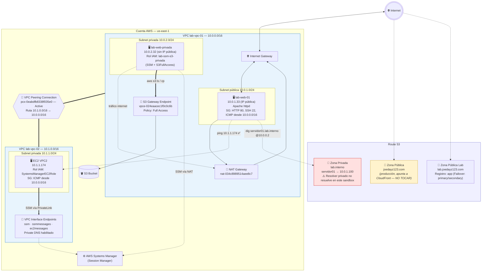

# Módulo 1 — Diagrama de arquitectura completo

Este diagrama resume todo lo construido a lo largo del Módulo 1 (IAM + VPC + Route 53), incluyendo los 3 niveles de laboratorio: Básico, Intermedio y Avanzado.

## Leyenda y estado de cada componente

| # | Componente | Detalle | Estado |
|---|---|---|---|
| 1 | `lab-vpc-01` (10.0.0.0/16) | VPC principal con subnet pública + privada, IGW, NAT Gateway | ✅ Funcionando |
| 2 | `lab-vpc-02` (10.1.0.0/16) | VPC secundaria, solo subnet privada, sin IGW/NAT | ✅ Funcionando |
| 3 | VPC Peering (`pcx-...`) | Conecta ambas VPCs, rutas agregadas en ambos lados | ✅ Activa, ping exitoso |
| 4 | EC2 pública `lab-web-01` | Apache httpd mostrando hostname/IP/AZ | ✅ Funcionando |
| 5 | EC2 privada VPC1 `lab-web-privada` | Acceso sin SSH vía **SSM Session Manager** (a través de NAT) | ✅ Funcionando |
| 6 | EC2 privada VPC2 | Acceso sin SSH vía **SSM Session Manager** (a través de VPC Interface Endpoints, sin salida a internet) | ✅ Funcionando |
| 7 | S3 Gateway Endpoint | Acceso a S3 desde subnet privada sin pasar por NAT/Internet | ✅ Funcionando |
| 8 | Zona pública `joedayz123.com` | Dominio de producción (apunta a CloudFront) — **no se tocó** | ✅ Intacto |
| 9 | Zona pública `lab.joedayz123.com` | Usada para Health Check + Failover Routing (`app` primary/secondary) | ✅ Funcionando |
| 10 | Zona privada `lab.interno` | Registro `servidor01 → 10.0.1.100` correctamente configurado y asociado a la VPC | ⚠️ El Resolver de la VPC (10.0.0.2) no resuelve zonas privadas en este entorno sandbox — descartado como error de configuración tras diagnóstico exhaustivo (zona, VPC, DHCP options, reglas de Resolver, DNS Firewall, caché, propagación — todo validado) |

## Notas para la clase

- El punto **10 (DNS privado)** es el único pendiente: toda la configuración es correcta según el estándar de AWS, pero el entorno de laboratorio (sandbox) no refleja la resolución. Es un buen caso de estudio de **metodología de troubleshooting** (se descartó causa por causa con evidencia de CLI/CloudTrail) aunque no se haya resuelto el síntoma final.
- El acceso a instancias privadas **sin keypair ni SSH** se logró con **AWS Systems Manager Session Manager**, usando dos variantes de conectividad de red:
  - **VPC1**: saliendo por NAT Gateway (requiere solo el rol IAM).
  - **VPC2**: 100% privado, sin salida a internet, usando VPC Interface Endpoints (`ssm`, `ssmmessages`, `ec2messages`).
